# Predictive Maintenance Database: Show Us Your Data

**Course:** 44661 Databases for Analytics, Module 7 Final Project
**Author:** Abdelhafidh Mahouel
**Database:** PostgreSQL 18 with pgAdmin 4, on Windows 11

## Key Findings

- **Component 2 is the weak point:** it accounts for 259 of the 761 failures (34%).
- **Model 1 is the least reliable:** 11.81 failures per machine, about double model 4 (5.72).
- **Failures step up after ten years of age:** older machines fail about 1.7 times as often.
- **The sensors give a warning:** in the 24 hours before a failure, rotation drops 6.6% while vibration, pressure, and voltage rise.

## Contents

1. [Overview](#1-overview)
2. [Data Source](#2-data-source)
3. [Data Format](#3-data-format)
4. [Data Dictionary](#4-data-dictionary)
5. [Table Structure](#5-table-structure)
6. [My Process](#6-my-process)
7. [Obstacles and How I Overcame Them](#7-obstacles-and-how-i-overcame-them)
8. [Select * From Each Table](#8-select--from-each-table)
9. [Interesting Queries](#9-interesting-queries)
10. [Insights](#10-insights)
11. [Conclusion](#11-conclusion)
12. [How to Reproduce](#12-how-to-reproduce)
13. [AI Use Statement](#13-ai-use-statement)
14. [Acknowledgments](#14-acknowledgments)

## 1. Overview

For this project I built a relational database from industrial equipment data. The data describes 100 machines over one year: hourly sensor readings, error logs, maintenance records, and component failures. I chose it because it relates to process engineering, where the main questions are which equipment fails, why it fails, and whether the sensor data gives a warning before it happens.

The finished database has 5 tables, 21 columns, and 884,166 rows.

### Repository structure

```
predictive-maintenance-db/
├── README.md          This report
├── data/              The five source CSV files
├── sql/               All SQL used, in the order it was run
│   ├── 01_create_tables.sql
│   ├── 02_load_data.sql
│   ├── 03_verify_data.sql
│   ├── 04_analysis_queries.sql
│   └── 05_add_indexes.sql
├── images/            Screenshots of the query results, and charts
└── scripts/           Python script that draws the charts
```

## 2. Data Source

- **Dataset:** Microsoft Azure Predictive Maintenance
- **Location:** Kaggle, https://www.kaggle.com/datasets/arnabbiswas1/microsoft-azure-predictive-maintenance
- **Access:** Free to download with a Kaggle account
- **Period covered:** Sensor readings from January 1, 2015 to January 1, 2016. Maintenance records begin in 2014.
- **Copy in this repository:** the files are in the [data](data) folder

## 3. Data Format

The data came as five comma-separated (CSV) files, each with a header row.

| Source file | Loaded into table | Columns in file | Rows |
|---|---|---|---|
| PdM_machines.csv | machines | 3 | 100 |
| PdM_telemetry.csv | telemetry | 6 | 876,100 |
| PdM_errors.csv | errors | 3 | 3,919 |
| PdM_maint.csv | maintenance | 3 | 3,286 |
| PdM_failures.csv | failures | 3 | 761 |
| **Total** | | **18** | **884,166** |

The telemetry file is the large one: 100 machines with 8,761 hourly readings each.

## 4. Data Dictionary

### machines (100 rows)

| Column | Data type | Description |
|---|---|---|
| machine_id | integer | Unique ID of the machine (1 to 100). Primary key. |
| model | varchar(20) | Machine model, model1 through model4. |
| age | integer | Age of the machine in years (0 to 20). |

### telemetry (876,100 rows)

| Column | Data type | Description |
|---|---|---|
| reading_time | timestamp | Date and hour of the sensor reading. |
| machine_id | integer | Machine the reading came from. Foreign key to machines. |
| volt | numeric(12,6) | Voltage reading. |
| rotate | numeric(12,6) | Rotation speed reading. |
| pressure | numeric(12,6) | Pressure reading. |
| vibration | numeric(12,6) | Vibration reading. |

The primary key is the combination of machine_id and reading_time.

### errors (3,919 rows)

| Column | Data type | Description |
|---|---|---|
| error_no | integer (serial) | Row number I added as the primary key. |
| error_time | timestamp | Date and hour the error was logged. |
| machine_id | integer | Machine that logged the error. Foreign key to machines. |
| error_id | varchar(20) | Type of error, error1 through error5. These are non-breaking errors: the machine keeps running. |

### maintenance (3,286 rows)

| Column | Data type | Description |
|---|---|---|
| maint_no | integer (serial) | Row number I added as the primary key. |
| maint_time | timestamp | Date and hour of the maintenance. |
| machine_id | integer | Machine that was serviced. Foreign key to machines. |
| component | varchar(20) | Component that was replaced, comp1 through comp4. |

### failures (761 rows)

| Column | Data type | Description |
|---|---|---|
| failure_no | integer (serial) | Row number I added as the primary key. |
| failure_time | timestamp | Date and hour of the failure. |
| machine_id | integer | Machine that failed. Foreign key to machines. |
| component | varchar(20) | Component that failed, comp1 through comp4. |

## 5. Table Structure

The machines table is the parent. The other four tables each link back to it through machine_id.

The diagram below was generated by the pgAdmin ERD tool from the live database. The key icons mark primary keys, and each line links a table's machine_id back to the machines table:

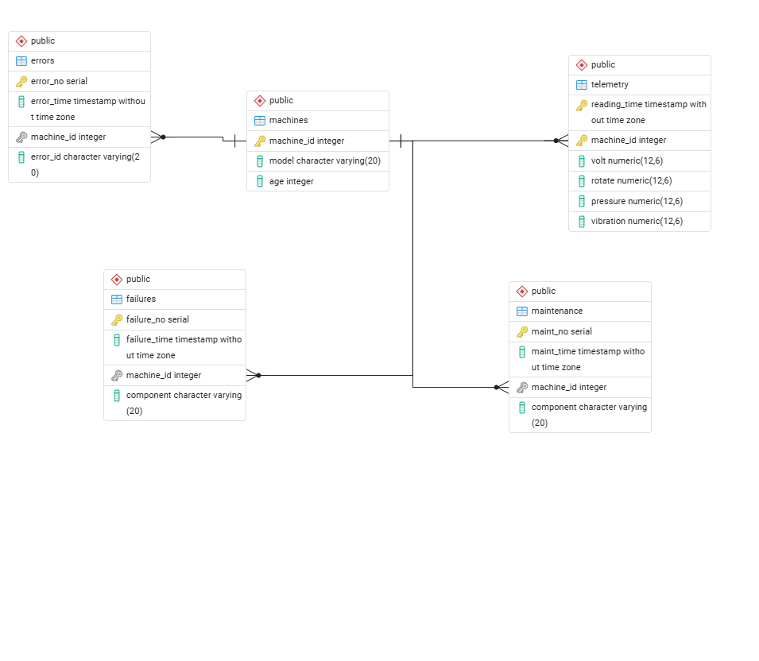

The SQL I used to create the tables:

```sql
CREATE TABLE machines (
    machine_id integer PRIMARY KEY,
    model      varchar(20),
    age        integer
);

CREATE TABLE telemetry (
    reading_time timestamp,
    machine_id   integer REFERENCES machines(machine_id),
    volt         numeric(12,6),
    rotate       numeric(12,6),
    pressure     numeric(12,6),
    vibration    numeric(12,6),
    PRIMARY KEY (machine_id, reading_time)
);

CREATE TABLE errors (
    error_no   serial PRIMARY KEY,
    error_time timestamp,
    machine_id integer REFERENCES machines(machine_id),
    error_id   varchar(20)
);

CREATE TABLE maintenance (
    maint_no   serial PRIMARY KEY,
    maint_time timestamp,
    machine_id integer REFERENCES machines(machine_id),
    component  varchar(20)
);

CREATE TABLE failures (
    failure_no   serial PRIMARY KEY,
    failure_time timestamp,
    machine_id   integer REFERENCES machines(machine_id),
    component    varchar(20)
);
```

The structure as stored in PostgreSQL, with the data type of every column:

```sql
SELECT table_name, column_name, data_type
FROM information_schema.columns
WHERE table_schema = 'public'
ORDER BY table_name, ordinal_position;
```

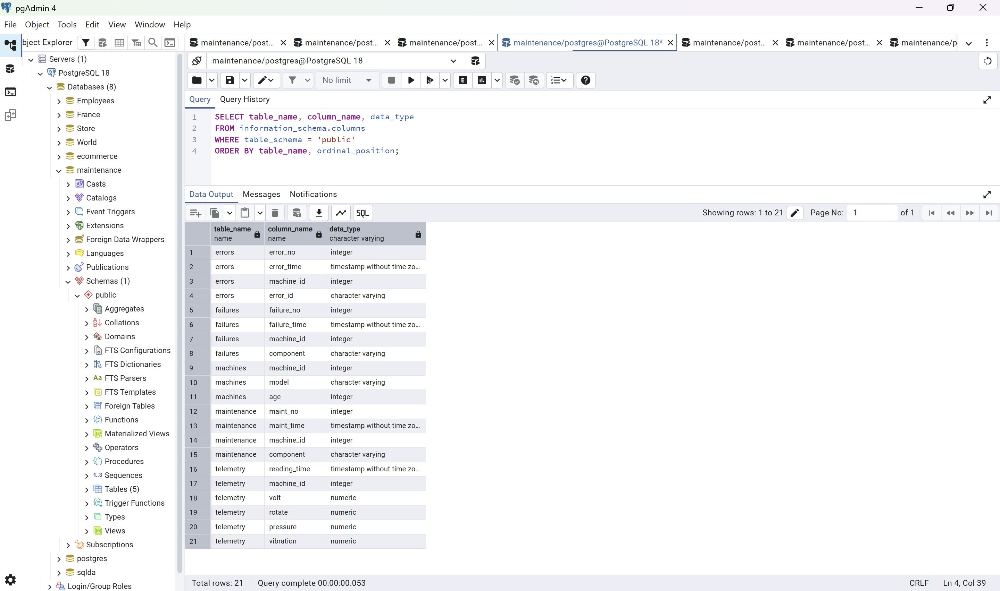

The database includes all three required data types: date (timestamp), numeric (integer and numeric), and string (varchar).

## 6. My Process

### Locating the data

I wanted data related to process engineering, so I searched Kaggle for industrial and maintenance datasets. I picked this one because it already came as several related files that share a machine ID, which makes it a natural fit for a relational database.

### Installing the data

1. Downloaded the dataset from Kaggle and extracted the five CSV files to `C:\temp`.
2. Created a new database called `maintenance` in pgAdmin.
3. Created the five tables with the SQL shown above.
4. Loaded each file with the COPY command, starting with the parent table:

```sql
COPY machines FROM 'C:\temp\PdM_machines.csv'
WITH (FORMAT csv, HEADER true);

COPY telemetry FROM 'C:\temp\PdM_telemetry.csv'
WITH (FORMAT csv, HEADER true);

COPY errors (error_time, machine_id, error_id) FROM 'C:\temp\PdM_errors.csv'
WITH (FORMAT csv, HEADER true);

COPY maintenance (maint_time, machine_id, component) FROM 'C:\temp\PdM_maint.csv'
WITH (FORMAT csv, HEADER true);

COPY failures (failure_time, machine_id, component) FROM 'C:\temp\PdM_failures.csv'
WITH (FORMAT csv, HEADER true);
```

### Verifying the data

First I confirmed the row counts matched the source files:

```sql
SELECT 'machines' AS table_name, COUNT(*) AS row_count FROM machines
UNION ALL SELECT 'telemetry', COUNT(*) FROM telemetry
UNION ALL SELECT 'errors', COUNT(*) FROM errors
UNION ALL SELECT 'maintenance', COUNT(*) FROM maintenance
UNION ALL SELECT 'failures', COUNT(*) FROM failures;
```

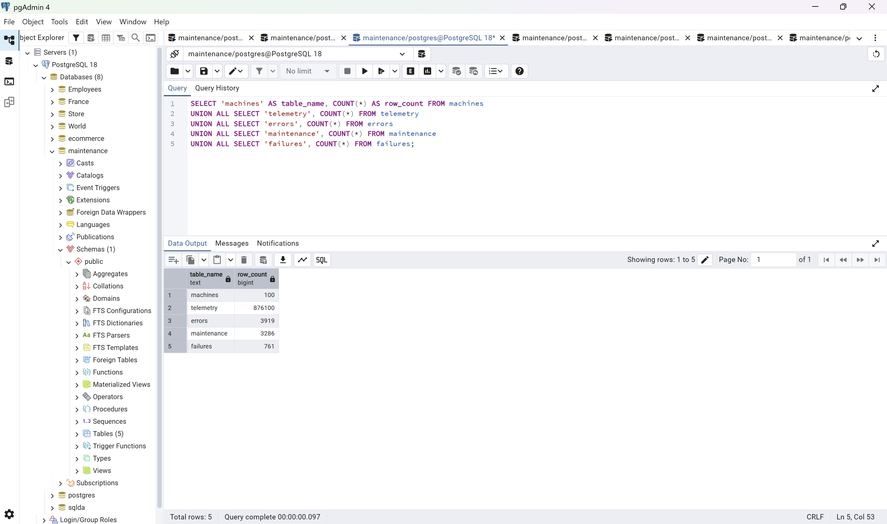

Then I checked the date range and confirmed all 100 machines were reporting:

```sql
SELECT MIN(reading_time) AS first_reading,
       MAX(reading_time) AS last_reading,
       COUNT(DISTINCT machine_id) AS machines_reporting
FROM telemetry;
```

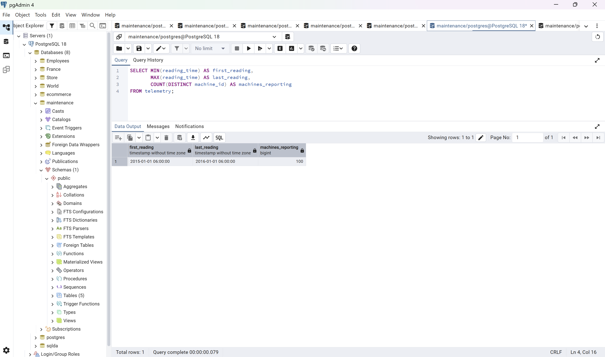

The readings run from 2015-01-01 06:00 to 2016-01-01 06:00 for all 100 machines. That is exactly one year of hourly data, which matches the 876,100 rows (100 machines x 8,761 hours).

## 7. Obstacles and How I Overcame Them

**The event files had no unique key.** In the errors, maintenance, and failures files, the same machine can have more than one event at the same date and time. For example, machine 2 had both comp1 and comp2 fail on 2015-03-19 at 06:00. That meant I could not use machine and time as a primary key. I solved it by adding a serial column to each of these tables (error_no, maint_no, failure_no) as the primary key.

**Adding a serial column changed how COPY works.** Once the table had one more column than the file, a plain COPY no longer lined up. I fixed it by listing the columns to load in the COPY command, for example `COPY errors (error_time, machine_id, error_id)`, so PostgreSQL filled in the serial number itself.

**Column names needed cleaning up.** The source files use names like `datetime` and `machineID`. I renamed them to clearer names that follow one style (reading_time, error_time, machine_id). Because I used `HEADER true`, the header row was skipped and the names in the file did not have to match my table.

**Header rows and data types.** The lecture example had to load everything as text first and fix the types later, because the header row was being imported as data. Since my files were CSV, the `HEADER true` option let me load straight into timestamp and numeric columns in one step.

**Load order mattered.** Every table has a foreign key to machines, so the machines table had to be loaded first or the other loads would have been rejected.

**Viewing each table.** When I ran all five `SELECT *` statements together, pgAdmin only showed the result of the last one. I ran each statement separately to see and capture every table.

## 8. Select * From Each Table

```sql
SELECT * FROM machines LIMIT 10;
```

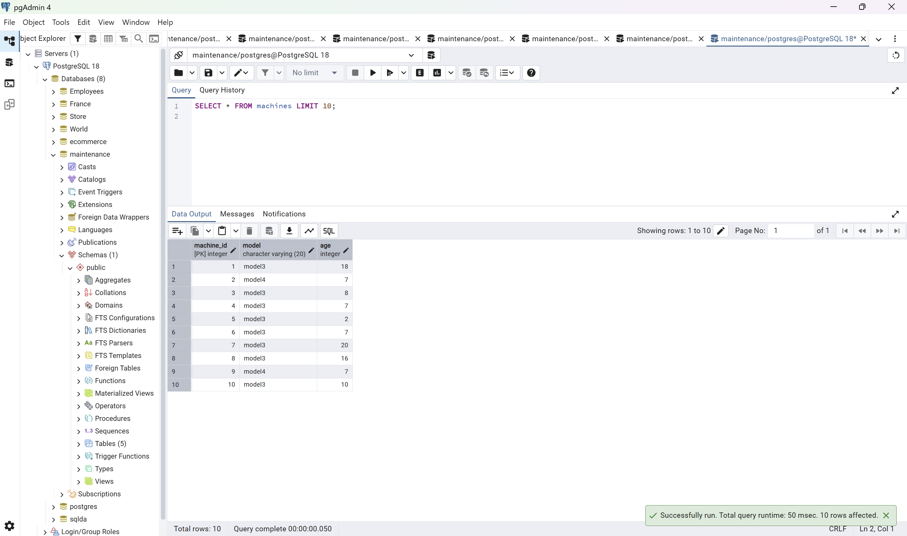

```sql
SELECT * FROM telemetry LIMIT 10;
```

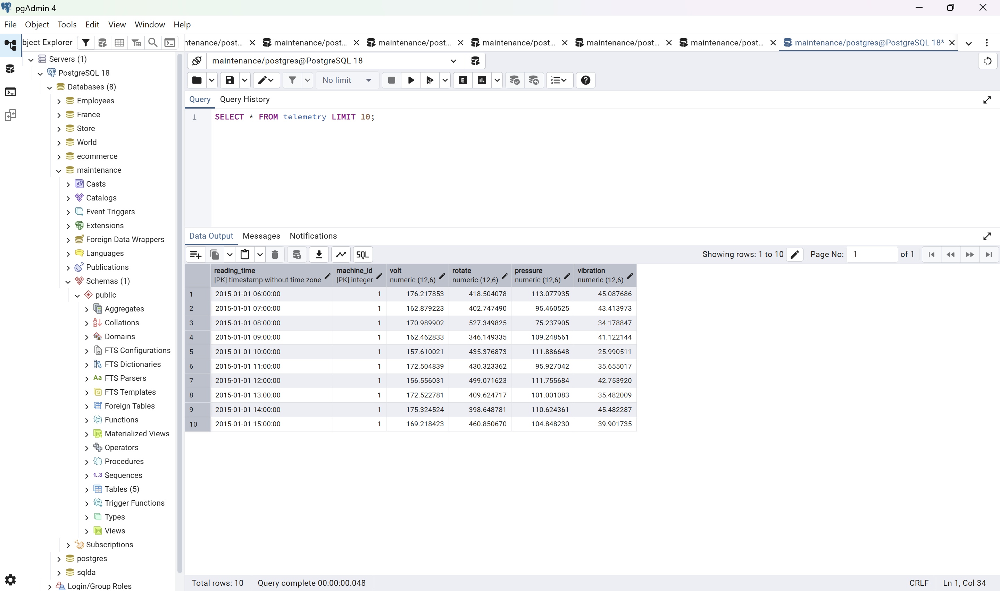

```sql
SELECT * FROM errors LIMIT 10;
```

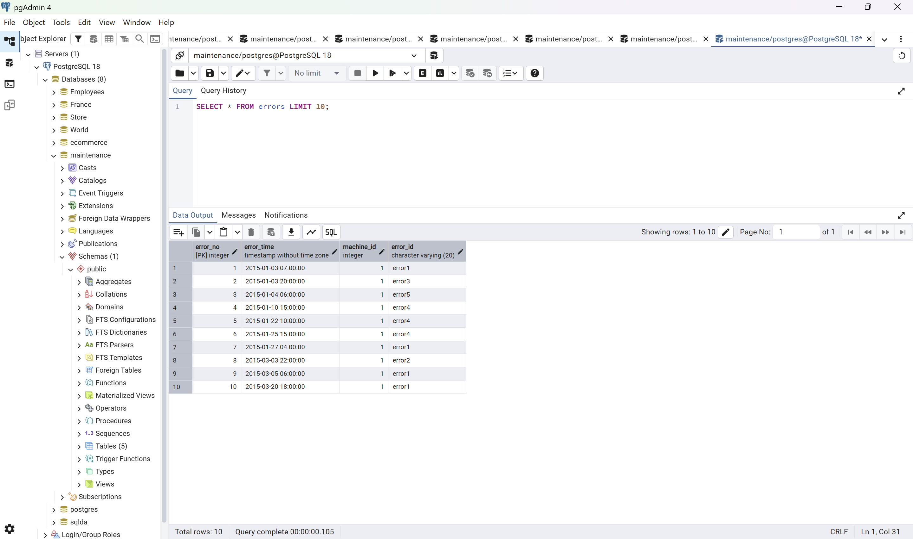

```sql
SELECT * FROM maintenance LIMIT 10;
```

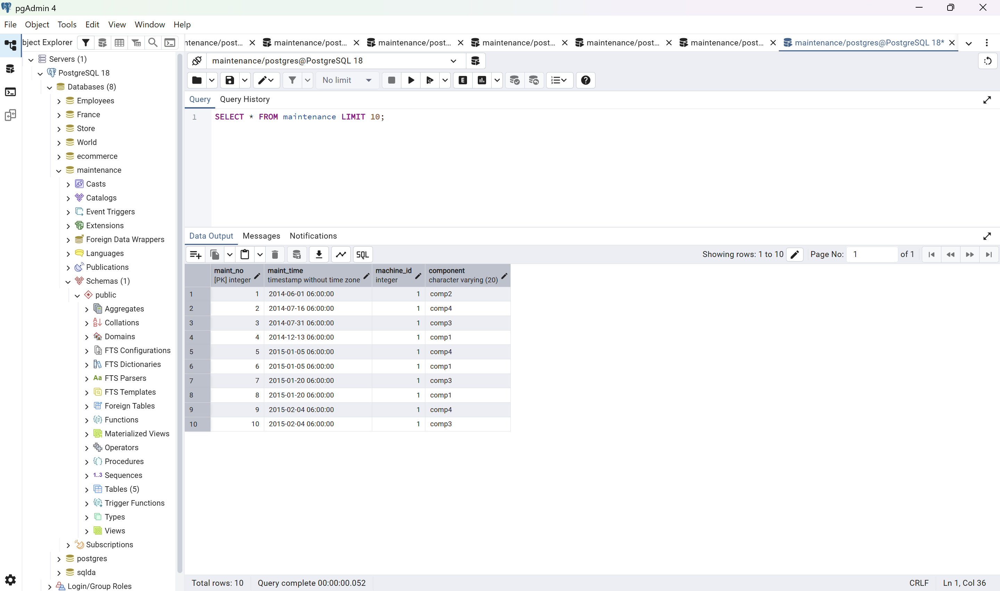

```sql
SELECT * FROM failures LIMIT 10;
```


## 9. Interesting Queries

### Query 1: Which component fails most? (group by and aggregate)

```sql
SELECT component, COUNT(*) AS total_failures
FROM failures
GROUP BY component
ORDER BY total_failures DESC;
```

| component | total_failures |
|---|---|
| comp2 | 259 |
| comp1 | 192 |
| comp4 | 179 |
| comp3 | 131 |

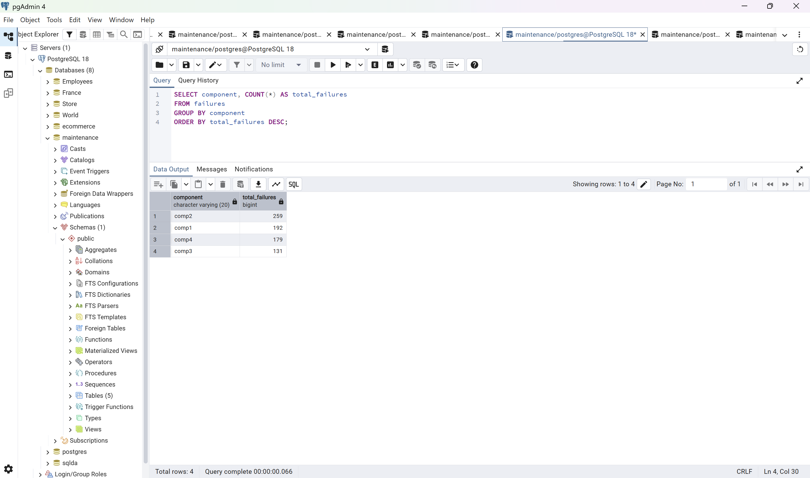

### Query 2: Which machine model fails most? (join, group by, aggregate)

```sql
SELECT m.model,
       COUNT(DISTINCT m.machine_id) AS machines,
       COUNT(f.failure_no)          AS total_failures,
       ROUND(COUNT(f.failure_no)::numeric
             / COUNT(DISTINCT m.machine_id), 2) AS failures_per_machine
FROM machines m
LEFT JOIN failures f ON f.machine_id = m.machine_id
GROUP BY m.model
ORDER BY failures_per_machine DESC;
```

| model | machines | total_failures | failures_per_machine |
|---|---|---|---|
| model1 | 16 | 189 | 11.81 |
| model2 | 17 | 168 | 9.88 |
| model3 | 35 | 221 | 6.31 |
| model4 | 32 | 183 | 5.72 |

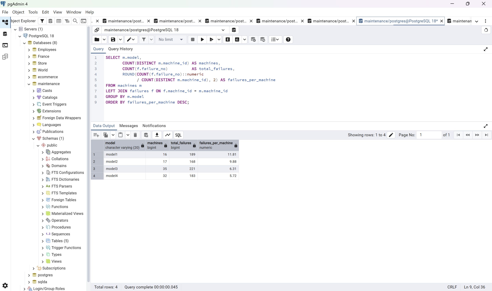

### Query 3: Do older machines fail more? (join, group by, aggregate)

```sql
SELECT CASE WHEN m.age <= 5  THEN '0-5 years'
            WHEN m.age <= 10 THEN '6-10 years'
            WHEN m.age <= 15 THEN '11-15 years'
            ELSE '16-20 years' END AS age_group,
       COUNT(DISTINCT m.machine_id) AS machines,
       COUNT(f.failure_no)          AS total_failures,
       ROUND(COUNT(f.failure_no)::numeric
             / COUNT(DISTINCT m.machine_id), 2) AS failures_per_machine
FROM machines m
LEFT JOIN failures f ON f.machine_id = m.machine_id
GROUP BY 1
ORDER BY MIN(m.age);
```

| age_group | machines | total_failures | failures_per_machine |
|---|---|---|---|
| 0-5 years | 21 | 124 | 5.90 |
| 6-10 years | 26 | 140 | 5.38 |
| 11-15 years | 24 | 221 | 9.21 |
| 16-20 years | 29 | 276 | 9.52 |

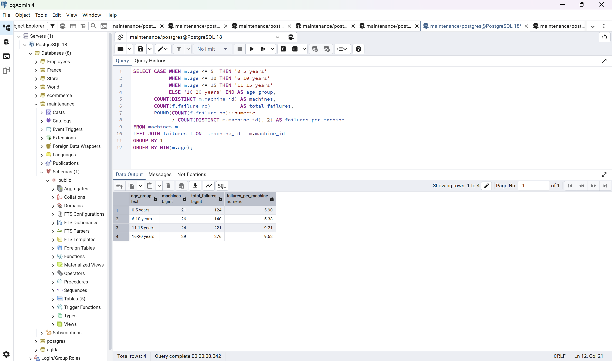

### Query 4: Do the sensors change before a failure? (join on a time window)

This query compares the average of all sensor readings with the average of the readings taken in the 24 hours before each failure.

```sql
SELECT 'All readings' AS period,
       ROUND(AVG(volt), 2)      AS avg_volt,
       ROUND(AVG(rotate), 2)    AS avg_rotate,
       ROUND(AVG(pressure), 2)  AS avg_pressure,
       ROUND(AVG(vibration), 2) AS avg_vibration
FROM telemetry
UNION ALL
SELECT '24 hours before a failure',
       ROUND(AVG(t.volt), 2),
       ROUND(AVG(t.rotate), 2),
       ROUND(AVG(t.pressure), 2),
       ROUND(AVG(t.vibration), 2)
FROM failures f
JOIN telemetry t
  ON t.machine_id = f.machine_id
 AND t.reading_time >= f.failure_time - INTERVAL '24 hours'
 AND t.reading_time <  f.failure_time;
```

| period | avg_volt | avg_rotate | avg_pressure | avg_vibration |
|---|---|---|---|---|
| All readings | 170.78 | 446.61 | 100.86 | 40.39 |
| 24 hours before a failure | 176.16 | 417.20 | 105.57 | 42.91 |

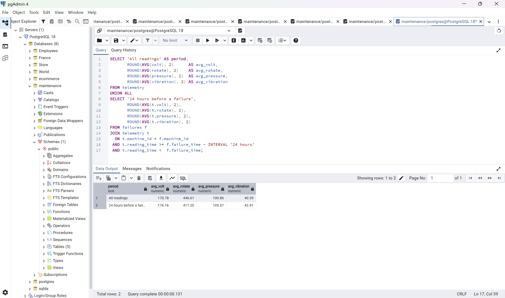

### Query 5: The ten machines with the most failures (subqueries across four tables)

```sql
SELECT m.machine_id, m.model, m.age,
       (SELECT COUNT(*) FROM failures f     WHERE f.machine_id  = m.machine_id) AS failures,
       (SELECT COUNT(*) FROM errors e       WHERE e.machine_id  = m.machine_id) AS errors,
       (SELECT COUNT(*) FROM maintenance mt WHERE mt.machine_id = m.machine_id) AS maintenance_records
FROM machines m
ORDER BY failures DESC, errors DESC
LIMIT 10;
```

| machine_id | model | age | failures | errors | maintenance_records |
|---|---|---|---|---|---|
| 99 | model1 | 14 | 19 | 54 | 34 |
| 98 | model2 | 20 | 16 | 45 | 37 |
| 22 | model1 | 14 | 15 | 60 | 33 |
| 17 | model1 | 14 | 15 | 49 | 32 |
| 83 | model4 | 18 | 14 | 44 | 34 |
| 37 | model1 | 16 | 14 | 43 | 35 |
| 20 | model2 | 16 | 13 | 47 | 33 |
| 71 | model2 | 18 | 13 | 45 | 33 |
| 13 | model1 | 15 | 13 | 42 | 33 |
| 16 | model1 | 3 | 13 | 41 | 29 |

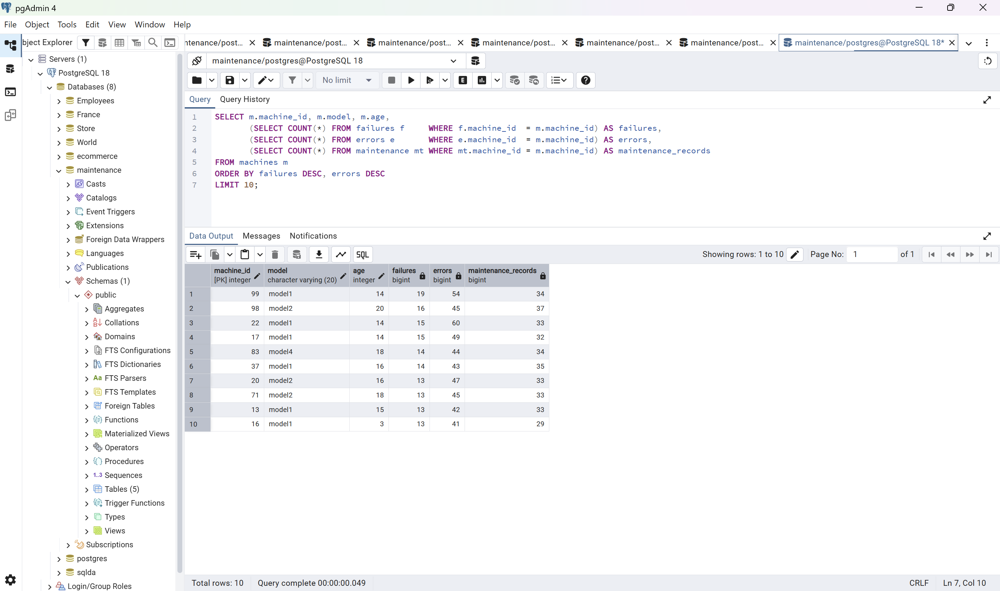

## 10. Insights

1. **Component 2 is the weak point.** It accounts for 259 of the 761 failures (34%), about twice as many as component 3 (131). If spare parts or inspection time are limited, component 2 is where to focus first.

   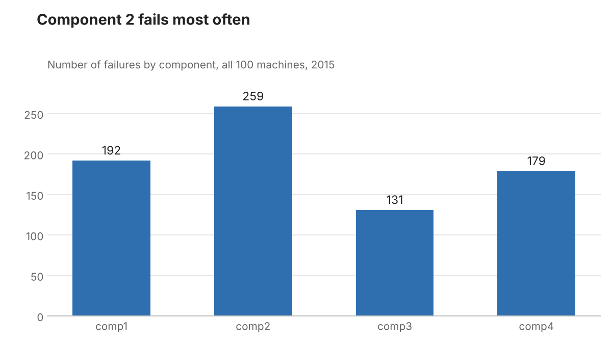

2. **Machine model matters more than fleet size suggests.** Model 3 has the most failures in total (221), but only because there are 35 of them. Per machine, model 1 is the worst at 11.81 failures a year, about double model 4 at 5.72. Looking at totals alone would have pointed at the wrong model.

   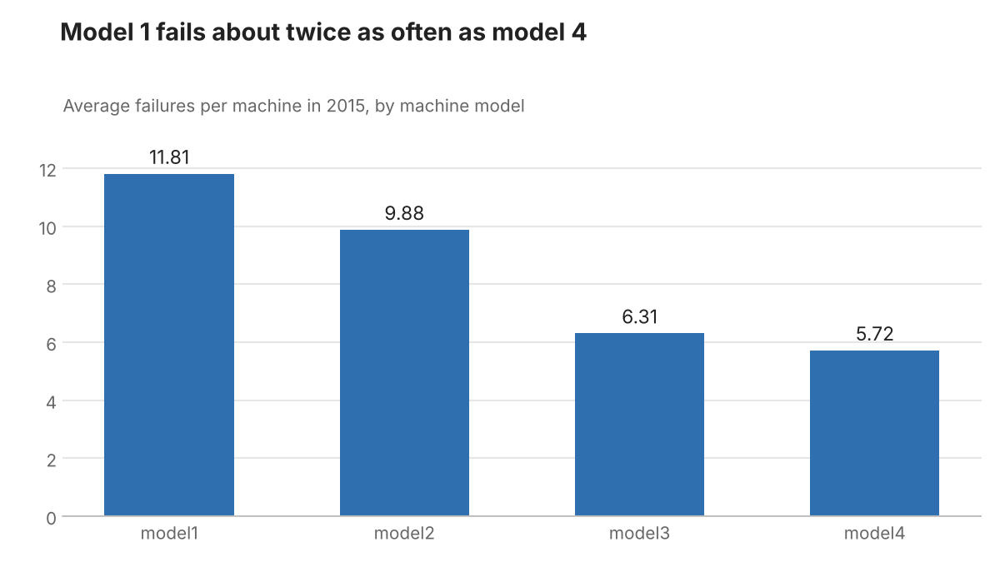

3. **Failures jump after ten years of age.** Machines up to 10 years old average about 5.6 failures a year. Machines older than 10 years average about 9.4, roughly 1.7 times as many. The increase is a step, not a gradual climb, which suggests a point where replacing a machine may cost less than keeping it running.

   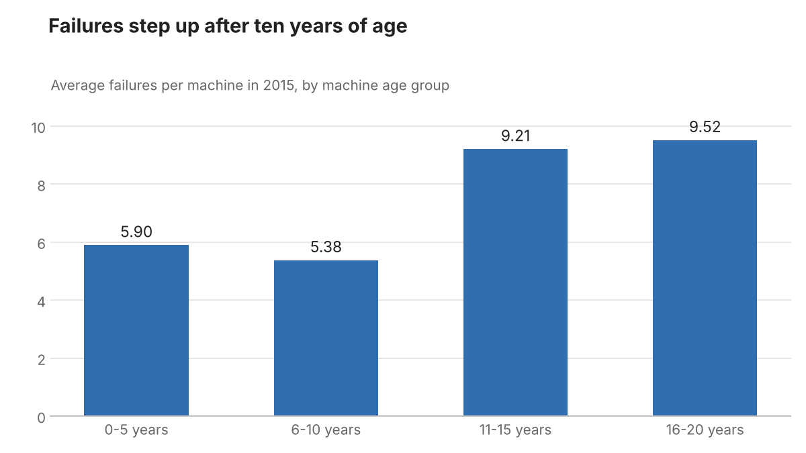

4. **The sensors give a warning.** In the 24 hours before a failure, average rotation is 6.6% lower than normal, while vibration is 6.2% higher, pressure 4.7% higher, and voltage 3.2% higher. These are averages over all failure types, so the signal for a specific component is probably stronger. This is the basis for predictive maintenance: watching these readings could flag a machine before it breaks.

   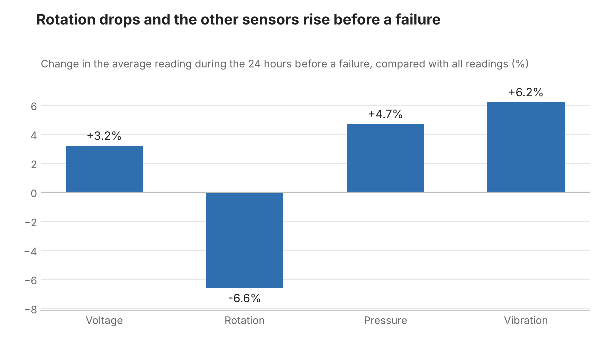

5. **Age and model combine.** Nine of the ten machines with the most failures are 14 years or older, and six of the ten are model 1. The one young machine on the list (machine 16, 3 years old) is also a model 1, which shows the model effect exists even without the age effect.

## 11. Conclusion

I started with five raw CSV files and ended with a verified PostgreSQL database of 884,166 rows across five related tables. Building it showed me that the design decisions, such as how to key tables that have no natural unique key, take more thought than the loading itself. With the data in a relational structure, a few joins were enough to answer practical maintenance questions about which components, models, and ages of machine deserve the most attention.

## 12. How to Reproduce

1. Install PostgreSQL and pgAdmin.
2. Copy the five CSV files from the [data](data) folder to `C:\temp` (or edit the paths in `sql/02_load_data.sql`).
3. In pgAdmin, create a database named `maintenance` and open its Query Tool.
4. Run the files in the [sql](sql) folder in order:
   - `01_create_tables.sql` creates the five tables.
   - `02_load_data.sql` loads the CSV files. Run one statement at a time.
   - `03_verify_data.sql` checks the row counts, structure, and date range.
   - `04_analysis_queries.sql` runs the five analysis queries.
   - `05_add_indexes.sql` is optional and adds indexes on the foreign keys.
5. The row counts should be 100 machines, 876,100 telemetry readings, 3,919 errors, 3,286 maintenance records, and 761 failures.

To redraw the charts, install matplotlib and run `python scripts/make_charts.py` from the project folder.

## 13. AI Use Statement

In line with the course policy on the use of artificial intelligence, I used generative AI tools as a productivity aid on this project. They supported planning the database, drafting and debugging the SQL, and preparing this documentation.

I ran every query myself in pgAdmin on my own database, and the screenshots and results shown here come from that database. I am responsible for the correctness, design choices, and interpretation of this work.

## 14. Acknowledgments

- **Data:** Microsoft Azure Predictive Maintenance dataset, published on Kaggle.
